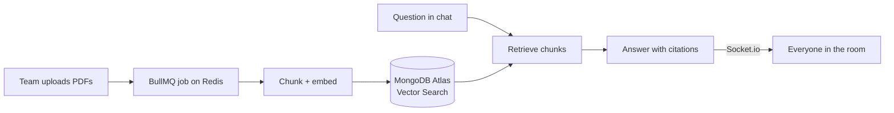

```text
 █████╗ ███╗   ███╗ █████╗ ███╗   ██╗     █████╗ ██╗  ██╗███╗   ███╗ █████╗ ██████╗
██╔══██╗████╗ ████║██╔══██╗████╗  ██║    ██╔══██╗██║  ██║████╗ ████║██╔══██╗██╔══██╗
███████║██╔████╔██║███████║██╔██╗ ██║    ███████║███████║██╔████╔██║███████║██║  ██║
██╔══██║██║╚██╔╝██║██╔══██║██║╚██╗██║    ██╔══██║██╔══██║██║╚██╔╝██║██╔══██║██║  ██║
██║  ██║██║ ╚═╝ ██║██║  ██║██║ ╚████║    ██║  ██║██║  ██║██║ ╚═╝ ██║██║  ██║██████╔╝
╚═╝  ╚═╝╚═╝     ╚═╝╚═╝  ╚═╝╚═╝  ╚═══╝    ╚═╝  ╚═╝╚═╝  ╚═╝╚═╝     ╚═╝╚═╝  ╚═╝╚═════╝
```


<!-- ascii-avatar: me, drawn in characters -->
```text
                                     -----===++****++****
                                   -==--===-=-----------==++++=
                               ::--------==++++******+++==-=-=++
                               ++==--------=+***#%%%%%%%%%#*+======+*##
                              -=##+=+**###++=-=+*######*****#*+++++--=+##*+
                            +##=-*%%#%%###***+==++********++=**+=+**+==-+#%#+
                          +-+*%*=+%%*#########*+===+***+++***++*#++***++==*%%%#
                     ++=+-+++=++=+###*#%%%%%%%%#+=+*****######*+*#*+++==+=-+#%%%%*
                    =+#**==*#*++**+***+%#%##****+++##%###****###*****#*++++#*####%%*
                 -:-***###**********+=*%%%%%%####+*####%%##*#**##*#########@%#%%%#%%#
                +===+**###%#**###+++****+#%%%%%%%%#****#######**##**+=-----+%%%%%%%%%
               *#%%%***##**##%%#****++*+==*#####%%%%%#****####******++++=+#*+*%@@@%%#
               %%%%@%#%%%%#%%%#+=--=*+**+==+++*######%%###*####*****#+*#*==*#++*#%@@
               #%%%%@##%%%%%%%*=-:::+##*##==+==+*****######**#*###***++*##*+*+-=++%+
               %%%@@%%%%%%%%#*+-:::::=%#=##+-=====+++++++*#%#***#######****##+:++=
             =*#%%%@@%@%%%%%*=-:......:%#:#%-.:-----=======#%+++**###%%%##****+*+-
             -=+#%%@@@@@%%%#=::..      :@=.%%.  ...........:+--=*####%%%%%%#*+*#*+
              =+#%%@@@@%@@%=:.          ++.+%: .      ...::::---+**%%%%%%#*#@#**##
                 #%%@%@@%%+-..:--=++++++++--=:....-+*#%%%%%##***#**#%%%@%%%%%@%#%*
                  %%%%%###*=====+++*####***+:...:-*####*+=-----=%**###**%%%*%%%@@-
                  #@%@%#@@+---::-=+++*##*++**-::-*#++**+#*##*++=%+-+%#*#%%#%@%%%#
                   +#*%@*=--==*%%+*%%%*=#+===. .-*==+*=:*##*-*#*##==-. =@@@%%%%@+
                   -%##%- :.-=+=---++*+++==*=   .+*+=-=====---==-=*=.  .%%%+=*##
                   -**#%-        -==+==-::-=.    .==-:::-------:.. -   :%%#+-=+*
                    ++#@=            .....-:     ..-:........:.   ..   -@%#*=-+
                      *@*            ...:--.       .-+-::::::......  ..+%##*=+
                       #%            :::=.           :-::::::...  ....:=+=+=+
                                    .:::-::--:...-==-::::... .....:::::.---+
                                  .::::..:-+*+******+-..:::::.::::::::::-
                             ---:::--:::...:-=+**+=-:::::::--:-------
                            ------===++-:::::::::::-::-=*+=----------
                             ==--===*%#*++=+++========+*#%*=--------
                             ===--==+==---:-:-::--:------=+=--------
                              =======--:::--=+***+==-:..:-=====---==
                               =======-::...::---:.. ...::--=======
                               ======--:..           ...::---=====
                                =====-::.... ..... .....::-==+++=-
                                 ==++==---:-:------------=++*++==-
                                 --===++++*****##*#*********++==--
                                 ----===+*#%%%%%%%%%%%###*+==-----
                                 --------=+**#########**+=-:::----
                                 :------:-==+++*****++==-::::-----
                                 ::::::-----===========------:::::
```

<div align="center">

**full-stack engineer** · building at [10ex.ai](https://10ex.ai) · Hyderabad, India

[amanahmad.xyz](http://amanahmad.xyz) &nbsp;·&nbsp; [linkedin](https://www.linkedin.com/in/amanahmad1) &nbsp;·&nbsp; [amank225566@gmail.com](mailto:amank225566@gmail.com)

</div>

```console
$ whoami
aman. I build backend-heavy web apps.

$ cat focus.txt
real-time infra · AI integration · making things work in production, not just locally

$ ls ~/shipped
projectteams/   avmg/   kropigo/   watchthis/   solarvistar/

$ ./now --building
warden: any lecture goes in, notes + flashcards + an OMR quiz come out

$ uptime
not looking. always open to interesting problems.
```

---

## now building

```text
                    _
__ __ ____ _ _ _ __| |___ _ _
\ V  V / _` | '_/ _` / -_) ' \
 \_/\_/\__,_|_| \__,_\___|_||_|
```

**[Warden](https://github.com/wizardamxn/warden)** turns any YouTube lecture into study material, so you learn from the video instead of only watching it.

```text
┌─────────────────────────────────┬────────────────────────────────────────┐
│                                 │ 26:31  Levels of organisation          │
│              ▶ play             │        ▀▀▀▀▀▀▀▀▀▀▀▀▀▀▀▀▀▀▀▀▀▀▀         │
│                                 │        · cell → tissue → organ         │
│ ━━━━━━━━━━━━━━━━━○───── 26:40   │                                        │
│                                 │ 44:05  History: Robert Hooke           │
│ Cell: The Unit of Life          │        · coined "cell" in 1665         │
├─────────────────────────────────┴────────────────────────────────────────┤
│ notes · flashcards · answer sheet          (1) (2) (█) (4)    +4 right   │
└──────────────────────────────────────────────────────────────────────────┘
```

Captions → three separate Gemini calls (notes, flashcards, quiz), every answer checked in Go and saved step by step, so a crash never pays for the same work twice.

`Go` `Next.js` `Postgres` `Gemini` `YouTube IFrame API`

---

## shipped

**[ProjectTeams](https://projectteams.amanahmad.xyz)** · [`repo`](https://github.com/wizardamxn/projectteams)

Real-time team platform with chat, presence, and a RAG Q&A engine. Teams upload their own PDFs; the system chunks, embeds, and retrieves with citations. Sub-100ms message delivery over Socket.io. Nginx reverse proxy on EC2, Cloudflare + Let's Encrypt TLS in front.



`Socket.io` `BullMQ` `Redis` `MongoDB Vector Search` `Vercel AI SDK` `AWS EC2`

<br />

**[AVMG](https://avmg.amanahmad.xyz)** · [`frontend`](https://github.com/wizardamxn/avmg-f) &nbsp;[`backend`](https://github.com/wizardamxn/avmg-b)

Download and convert audio/video from virtually anything. FFmpeg pipeline, Redis-queued for repeat requests, Multer for uploads, Supabase for storage. Also generates AI notes from YouTube transcripts. Backend lives on AWS EC2.

```text
 any link ──▶ [ fetch ] ──▶ [ ffmpeg ] ──▶ [ supabase ] ──▶ your file
                  │
                  └──▶ seen it before? redis says yes, skip the work
```

`FFmpeg` `Redis` `Supabase` `PostgreSQL` `Next.js` `AWS EC2`

<br />

**[KropiGo](https://kropigo.in)** · *freelance, live in production*

Agri-marketplace connecting farmers (kisan) directly with buyers. Real-time listing and order updates, role-based flows for kisan/buyers/admins, marketplace moderation.

`Socket.io` `RTK Query` `Next.js` `MongoDB` `Cloudinary`

<br />

**[WatchThis](https://watchthis.amanahmad.xyz)** · [`repo`](https://github.com/wizardamxn/watchthis)

Movie recommendation app with AI-personalized suggestions, persistent watchlists, and full title metadata from TMDB.

`React` `Firebase` `TMDB API`

<br />

**SolarVistar** · *freelance, private*

CRM for a solar company in Khargone, MP. Lead and customer management, end to end, from requirements to deployment.

`RTK Query` `PostgreSQL` `Prisma` `MongoDB` `Cloudinary`

---

## the toolbox

<div align="center">


</div>

---

## off the clock

```text
  MON  ████████████  push
  TUE  ████████████  pull
  WED  ████████████  legs
  THU  ████████████  push
  FRI  ████████████  pull
  SAT  ████████████  legs
  SUN  ░░░░░░░░░░░░  valorant · bing-chilling
```

<details>
<summary>my crosshair, if you ask nicely</summary>

```text
              │
              │
              │
      ─────── ┼ ───────
              │
              │
              │
```

</details>

---

## activity

<div align="center">

<picture>
  <source media="(prefers-color-scheme: dark)" srcset="https://raw.githubusercontent.com/wizardamxn/wizardamxn/output/github-contribution-grid-snake-dark.svg" />
  
</picture>

<br /><br />


<br /><br />


&nbsp;


<br /><br />


</div>
